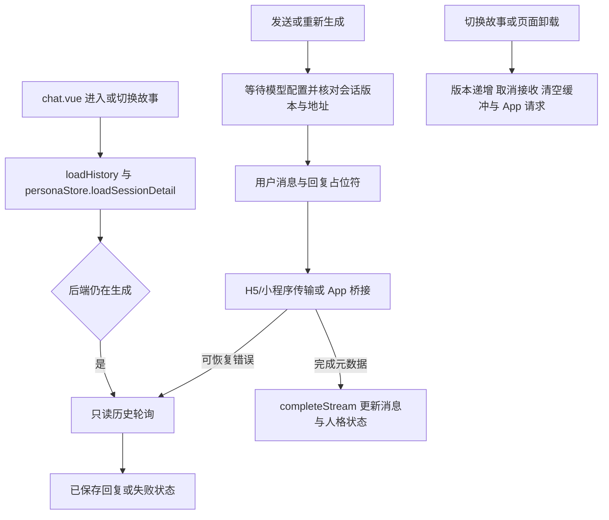

# 聊天 Store 生命周期评估

2026-10-26 完成初评，随后按下述第一批方案修复异步边界、编辑反馈和切服失效。本文保留初评时的观察，后续拆分仍待评估；当前实现规则见 [前端架构](../architecture/FRONTEND.md#流式聊天与会话隔离)，真机尚未验收。

本次先修边界，没有拆分 `chatStore.ts`。历史、分页与流式请求保留原有隔离机制，补充服务器地址检查；整体重写会同时扩大恢复、候选和跨端适配的验证范围。

## 当前调用链与状态归属



主要入口为 [chatStore.ts](../../app-frontend/src/store/chatStore.ts)、[页面生命周期](../../app-frontend/src/pages/chat/chat.vue)、[消息交互](../../app-frontend/src/composables/useChatMessageActions.ts) 和 [App 桥接](../../app-frontend/src/composables/useChatStreamBridge.ts)。

| 状态或机制 | 当前归属与作用 |
| --- | --- |
| `activeSessionId`、`sessionVersion` | Store 标识当前故事及请求代际；`loadHistory`、`setActiveSession`、`$reset` 使旧代际失效 |
| `streamCancellation` | 取消 H5/小程序接收；不表示服务端生成被取消 |
| `streamBaselines`、`recoveringStreams` | 记录发送前消息边界，防止恢复时接受旧回复，并避免同一占位符重复恢复 |
| `activeStreamRequest` | Store 提供 App 请求快照；桥接层按 `requestId` 过滤旧事件并去重终态 |
| 文本与思考缓冲、48 ms 定时器 | Store 合并流式更新；故事失效时清空，成功收尾前刷新 |
| `isLoading` | 同时覆盖历史加载、分页、配置准备、接收与恢复，不能只理解为网络连接状态 |
| `messages` 与人格状态 | 消息在聊天 Store，人格在 Persona Store；消息修改完成时存在跨 Store 回写 |
| 编辑草稿与编辑目标 | `useChatMessageActions` 管理独立版本与保存状态；按 Store 的明确结果判断是否关闭或显示错误 |

页面的 `onUnload` 调用聊天 `$reset`、取消 Persona 加载并重置桥接；页面隐藏不等于卸载。当前代码没有要求所有 `onHide` 都取消生成，不应在重构时擅自改变这一行为。

## 初评时验证的边界缺口

使用现有 `tests/helpers/load-ts.cjs` 加载实际 TypeScript、Vue 和 Pinia，以延迟 Promise 和替身 API 模拟。没有连接后端、真实数据库或模型。

| 优先级 | 场景与观察结果 | 原因及影响 |
| --- | --- | --- |
| 高 | 在故事 A 删除消息，响应前切换 B；A 的删除成功返回后，仍调用人格更新并写入旧好感度 | `deleteMessageById` 在 `await` 后没有会话代际校验；即使 B 列表中没有被删消息，也会无条件应用返回的人格状态 |
| 高 | 在 A 切换候选，随后进入正在加载的 B；A 请求失败后，B 出现旧错误且 `isLoading` 被置为 false | `switchActiveCandidate` 的成功和异常分支均未校验代际；异常调用共用 `setError`，影响新故事的加载状态 |
| 中 | 保存编辑时请求失败；原消息仍在，但编辑框关闭，草稿变为空字符串 | `editMessage` 仅记录异常并正常返回，`saveEdit` 随后始终执行 `cancelEdit`；调用方无法区分成功、失败和失效 |
| 待补页面验证 | A 服务器发送后断连，保持 Store 存活并改为 B 地址；下一轮恢复从 B 读取同一故事 ID 并接受结果 | `pollPendingGeneration` 校验版本、故事和占位符，但不校验服务器；发送前的地址检查不覆盖后续恢复。此场景在 Store 层已复现，正常页面导航能否触发尚未确认 |

初评时编辑成功回写也缺少代际检查；候选切换成功即使找不到旧消息，仍会更新当前人格。本次已将成功和失败分支一起保护，迟到结果不回写新上下文。

初评模拟的观察点分别为：新故事激活后仍收到旧人格更新；旧候选失败把新故事加载状态改为 false；编辑失败后草稿被清空；恢复读取记录出现新服务器地址。这些结果是修复前的复现，新增回归要求它们不再发生。

## 现有回归覆盖

在 `app-frontend/` 执行：

```bash
node --test tests/session-lifecycle.test.cjs tests/app-stream.test.cjs tests/generation-settings.test.cjs
```

初评时 43 项通过，覆盖历史乱序、旧分页与旧流失效、页面退出时的人格加载、App 请求 ID 与终态去重、后台生成恢复、旧回复边界以及模型配置等待和失败。它们当时没有覆盖上述迟到消息修改与编辑草稿失败场景；服务器间模型偏好隔离测试也不能证明聊天恢复隔离。

修复新增 `chat-mutations.test.cjs` 和 `connection-lifecycle.test.cjs`，覆盖原缺口、编辑目标版本、保存失败、实际地址持久化和作用域释放；修复时完整前端回归 174 项、类型检查和 H5/App Plus/微信小程序构建通过。离线回归与构建不能确认真机后台、页面栈和服务器切换的实际交互。

## 最小改动顺序

第一批已在原文件修复，保持 Store 对外方法名和三端传输接入方式。下列顺序保留为实施记录。

1. 为编辑、删除和候选切换补充延迟响应回归，包含成功、失败、切换故事及 `$reset` 后返回；断言消息、人格、错误和加载状态都不被旧操作修改。
2. 使用统一的上下文检查，捕获故事 ID、会话代际与服务器地址；异步返回后只有当前上下文可以提交本地状态。客户端忽略迟到结果不代表后端写入被撤销，重新进入原故事后仍以服务端历史为准。
3. 明确消息修改的成功、失败和失效结果。编辑只在成功且编辑目标仍匹配时关闭；失败保留草稿和可见反馈，迟到保存不能关闭后来打开的编辑目标。修改失败反馈不应通过共用 `setError` 清除无关加载任务。
4. 已接入实际地址保存函数：持久化成功且地址变化后同步通知活动 Store，清空聊天、人物和页面的旧故事上下文，结束本地等待。历史、接收、恢复和 Persona 读取同时保护地址及代际，避免停止回写后仍保持忙碌。页面栈和真机交互仍需目标平台验收。

第一批完成后运行 `npm test`、`npm run type-check`；影响跨端接收、连接变更或共享界面时按 [前端测试指南](../../app-frontend/tests/README.md) 执行三个平台构建并记录真机未验收范围。

第二批再评估小范围拆分。可以先提取发送与重新生成共用的请求参数装配，保留重新生成的消息边界与候选恢复差异；文本缓冲也可独立管理，但必须显式支持失效清理和成功刷新。请求代际、占位符与终态仍由 Store 统一协调，避免两个模块分别决定一次生成是否结束。

暂不把每个异步方法改成 composable，不引入新的状态机依赖，也不同时重写 `isLoading`、SSE 协议和 App 桥接。是否进一步拆分，取决于修复后调用链是否仍难以阅读，而不是文件是否超过某个行数。
