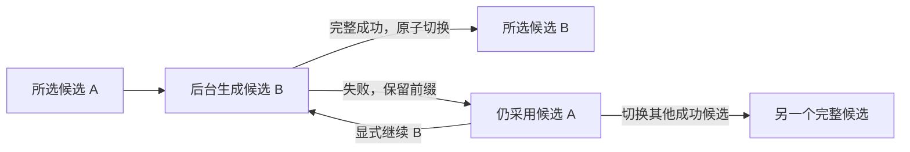

# M4：整轮候选与失败恢复设计

更新日期：2026-11-06。状态：M4-A–D 已实现，联合验收中。本文维护设计与接续证据；当前 HTTP 契约以[群聊 API](../../api/GROUP_SESSIONS.md) 为准。

[模块进度](README.md) · [需求基线](../GROUP_CHAT_PLAN.md) · [M3 执行基础](M3_DIRECTOR.md) · [M3 验收交接](../../testing/GROUP_CHAT_M3.md)

## 范围与前置条件

M4 负责接受用户轮次、整轮重生成、候选切换、下一轮确认、失败前缀续接，以及断连后的结果查询。所有角色仍由导演自动选择，串行生成；不增加手动选人、生成中插入消息或主动打断按钮。群聊记忆提纯、继承检索、关系和完整立绘面板留在 M5/M6，不能借确认操作调用旧单聊记忆入口。

M3 已有可复用的整轮执行、单元隔离、状态重放和版本保护；真实 API 的首轮协议阻断已修复，并有转述保密、知情沉默和 A→B→A 样本。更多语义质量及 App/微信真机仍待验收，不能登记为完成。这些未验收项不妨碍 M4 的数据与事务设计；涉及模型或界面的批次继续分别验证。

M4-A/B 阶段保留 `can_generate=false`；M4-C 已接通 HTTP，能力字段按运行权是否可用返回，Mock 仍为 false。M4-D 已接最小页面交互，不提前宣称 M5 的人格成长或正式首版已经完成。

## 设计基线与调整位置

| 当前证据 | 已有行为 | M4 调整 |
| --- | --- | --- |
| [ORM](../../../app-backend/core/models.py)、[轮次迁移回归](../../../app-backend/tests/infrastructure/test_group_round_migration.py) | Round/Candidate 身份、同轮版本、组合外键、单个未确认轮次的部分唯一索引 | 复用现有身份；增加会话版本、撤回标记、候选检查点与请求回执 |
| [历史服务](../../../app-backend/services/conversation/group_history_service.py)、[历史回归](../../../app-backend/tests/conversation/test_group_history.py) | `_prepare` 拒绝第二个未确认轮次；`_target` 要求所选且未确认；既有 `revision` 属于 Candidate | 增加受版本保护的确认与接受事务；执行中的新候选不必是所选候选，但必须绑定任务作用域 |
| [整轮服务](../../../app-backend/services/conversation/group_round_service.py)、[生成服务](../../../app-backend/services/conversation/group_generation_service.py) | 初判成功后才创建 Round；接受调度先落库；后判、正文和状态原子保存；失败保留前缀 | 接受回执先落库，执行器按持久检查点推进；终态同时结束请求并决定是否切换选择 |
| [个人状态](../../../app-backend/services/conversation/group_context_service.py)、[单元回归](../../../app-backend/tests/conversation/test_group_units.py) | 起点＋更早已确认所选候选＋本次候选的自身增量；过滤单元后装配输入 | 重生成排除同轮旧候选；预览与所选状态分开，撤回内容不参与重放 |
| [参数快照](../../../app-backend/services/conversation/group_call_snapshot.py) | 模型、采样和预算冻结在内存；连接对象含进程内凭据 | 持久化白名单参数用于显式续接，连接凭据仍只在进程中持有 |
| [锁](../../../app-backend/core/locking.py)、[生命周期](../../../app-backend/application/lifecycle.py)、[运行权](../../../app-backend/application/group_runtime.py) | 执行令牌绑定任务和会话；关闭等待清理；启动标记中断候选，不自动重发 | 后台任务持有自己的锁、令牌和数据库会话；请求断连不取消已接受任务；启动同时收敛请求回执 |
| [路由](../../../app-backend/routers/group_sessions.py)、[当前契约](../../api/GROUP_SESSIONS.md)、[前端类型](../../../app-frontend/src/types/groupSessions.ts) | 仅管理和只读轮次；`revision` 是所选候选版本，成员 state 展示起点 | 新增请求查询、候选和写操作；保留既有字段含义，不把起点字段改成运行时预览 |
| [前端流程](../../../app-frontend/src/composables/useGroupSessions.ts)、[Mock](../../../app-frontend/src/api/mock/groupSessions.ts) | 页面代际、切服失效和轮次 GET 已存在；Mock 不模拟生成 | 增加接受回执与 GET 轮询、候选操作及明确失败反馈；不通过重发 POST 恢复接收 |

## 一轮、一次执行和当前选择

Round 保存不可改写的用户原文；Candidate 表示这条用户输入的一套完整替代结果。原候选 A 和新候选 B 不混合正文、单元、知情、状态或审计。

请求回执表示一次已接受操作，不是另一套轮次身份。同一 Candidate 的一次失败和一次显式续接分别有不同回执，但仍使用原 Round/Candidate ID 和前缀。`Candidate.version` 表示同轮候选序号，`Candidate.revision` 表示该候选的写入版本，二者不能互换。

重生成开始时，A 继续是所选候选，B 只是任务的执行目标。只有 B 完整成功后，才在一个事务中将 B 标为 `awaiting_confirmation`、保存结束审计、切换所选指针并结束任务。B 失败则保留其前缀，A 的选择与状态不变。第一次发送没有旧候选可保留，初始候选可以同时是所选与执行目标。

同一会话只允许一个活动生成任务。生成期间拒绝新用户轮次、切换、重生成、续接、撤回和删除；读取仍可进行。正常停止的 `wait_user`、`no_visible_basis`、`step_limit` 都是完整成功，包括零角色发言；失败前缀不能直接冒充成功候选或进入确认。

## 拟增加的数据

以下字段与表已在 M4-A 同步加入 ORM 和新 Alembic 迁移 `b1e2f3a4b5c6`，沿用现有迁移链。

| 位置 | 拟增加内容 | 约束与用途 |
| --- | --- | --- |
| Session | `group_revision`，非负整数，旧记录默认 0 | 仅群聊服务使用；接受、选择、撤回、终态及中断收敛时原子递增。单聊行为保持不变 |
| GroupRound | `discarded_at` | 与 `confirmed_at` 互斥；保留撤回记录和请求归属，不复用 round_index |
| GroupRoundCandidate | `checkpoint`、`call_snapshot_json`、`provider_fingerprint` | 老记录允许为空；新任务必须有合法检查点与白名单参数，保留原 protocol_version |
| 新 GroupRoundOperation | ID、session/round/candidate 归属、`client_request_id`、kind、status、revision、规范化请求指纹、接受结果摘要、调用预算计数与时间、错误码 | `(session_id, client_request_id)` 唯一；queued/running 对 session 做部分唯一约束；候选使用同轮同群组合外键 |

kind 包含 send、regenerate、resume、select、discard。生成操作走 queued→running→succeeded/failed；select/discard 是短事务，直接写 succeeded 回执，不启动模型任务。终态不可被查询或重复请求重置为运行中，显式续接使用新请求 ID。

既有 Round 的未确认唯一索引改为 `confirmed_at IS NULL AND discarded_at IS NULL`。数据库禁止一轮同时确认和撤回，保持候选同轮同群外键及版本唯一约束。确认后的原文与选择由服务的写锁、`BEGIN IMMEDIATE` 和版本比较保护，不能声称普通 CHECK 已能保证历史字段不可变。

`group_revision` 保护会话操作，解决第一次发送、撤回后再次发送，以及 A→B→A 的旧请求问题。它不复用现有 `rounds[].revision`：该字段继续表示所选 Candidate 的 revision。候选每次内容、知情或审计提交仍递增自己的 revision；运行阶段和调用计数由 Operation.revision 表达，不把流式进度写成选择变化。

操作回执保留到整个群聊删除，不设置会过期后重新触发模型的幂等窗口。撤回保留原 Round 与回执，避免迟到的同请求 ID 将已撤回消息重新创建。所有新表在整群删除时级联，不触碰来源单聊；已有资源回收仍走 Outbox。

### 参数与连接

`call_snapshot_json` 只允许模型名、能力解析后的思考/采样/输出参数、成员参数、历史窗口、单次超时、最大成功步数和协议策略版本。不得保存 API Key、连接对象、完整 Prompt、角色卡副本、reasoning 或原始异常；序列化采用字段白名单，不能直接转存整个 settings 或对象字典。

同一候选续接沿用这份参数和原协议；重生成新候选可以使用新选择。连接凭据在每次实际执行起始从当前配置取出并在进程中冻结；允许同提供方正常轮换凭据。provider_fingerprint 仅对无凭据的规范化提供方地址作摘要，用于发现切服。地址不同或缺少旧快照时，拒绝以新配置假装延续原执行，提示重新生成。

M3 旧候选不伪造当时未保存的参数：成功候选仍可选择和确认；缺少可靠快照的失败候选只允许整轮重生成或撤回。v1 原文权限保持兼容，新重生成使用 v2；不在续接时静默改协议。

## 接受、确认与幂等

客户端在 POST 前生成 UUID 格式的 `client_request_id`。同群同 ID 同规范化请求返回已有回执；相同 ID 用于不同动作、内容、目标或版本时返回 409，不调用模型。指纹覆盖客户端输入及其默认值规范化结果，用户正文保持逐字一致；不把后来变化的服务器默认配置混入幂等比较。首次解析出的实际参数另存快照。

幂等查询优先于版本校验。已经接受的请求即使其 expected 版本随后过期，也不能被解释为一次新操作；回执说明当时接受了什么，当前选择与版本仍须通过 GET 查询。未接受的结构校验失败不消费请求 ID，不确认上一轮，也不创建候选。

发送下一条用户消息的接受事务依次完成：

1. 在群聊写锁及干净数据库事务内核对会话版本、最新有效轮次和所选候选。
2. 若有最新未确认轮次，只接受其所选候选已完整成功且没有活动操作的情况；设置该轮 confirmed_at 并先 flush，释放唯一索引槽位。
3. 新建下一轮、初始候选、sequence=0 用户项和 queued 请求回执，冻结非敏感调用参数；此时用户项还没有知情授权。
4. 递增 group_revision 并一起提交，随后才能发起第一个模型调用。

新建失败时整个事务回滚，上一轮仍未确认。提交明确成功后，上一轮已经由下一条持久化用户消息确认；后续新轮的初判失败、取消或生成失败不会把上一轮解冻。重生成、续接、切换以及 GET 都不会确认轮次。

能提前确定的请求结构、模型能力和基础长度错误在接受前拒绝。组合上下文预算或模型失败仍可能发生在接受后；届时回执与失败轮次必须可查询，不能让用户只能再次发送同一条消息。

新用户正文只保存在 Round，初判通过后为该候选的用户项写入原文范围、完整知情和审计，并推进 revision/checkpoint。初判前的草稿用户项不作为任何角色的可见依据；导演通过 pending_user_content 接收待判原文，已确认历史照常读取。

## 持久检查点与失败前缀

| checkpoint | 已经持久化的依据 | 显式续接从哪里开始 |
| --- | --- | --- |
| user_visibility | 已接受原文和草稿用户项，尚无可见单元 | 重新调用初判；此前未提交的范围不保留 |
| next_action | 用户计划和若干完整角色发言 | 以这些已保存内容重新调度，不重跑初判或旧发言 |
| role_generation | 一个已接受的 next_action 审计，尚未保存该步正文 | 复用该审计的真实发言者，再生成该步；不重复写调度审计 |
| finish | 成功发言数量已达到候选上限，只差最终事务 | 不调用模型，完成正常终态和选择切换 |
| done | 完整候选及正常终态 | 不允许续接；只能选择、整轮重生成或由下一用户消息确认 |

初判、接受调度、保存角色发言、结束事务分别在其原有原子边界中同步更新检查点。role_generation 包含角色生成到后判整个未提交步骤；后判失败时不保存半条发言，也不把暂存正文或内部状态放进恢复回执。若导演 end 决定没有连同终态成功提交，不把它记成已接受终态；恢复后允许从最后可靠调度检查点重新判断。

续接前核对前缀的原文覆盖、单元/知情完整性、最后接受的审计和检查点是否一致，role_generation 必须能唯一对应尚未保存发言的那次调度。失败与续接本身可以推进 Candidate.revision，不能仅因旧调度的 result_revision 小于当前 revision 就重复调度。缺少可靠依据时拒绝续接，允许重新生成或撤回；不能补造知情、从当前配置猜旧快照，或把损坏前缀静默当成恢复成功。

保存完成与取消交错时，以数据库明确提交结果为准。发言已经提交就保留前缀并推进下一检查点，不能把它重跑；最终成功事务已经提交就返回成功，不再改失败。写入失败标记遇到外部版本竞争，不借用对方 revision，也不覆盖新选择。

续接是用户显式发起的新执行尝试，可能重新调用未保存成功的那一步，该调用此前也可能已计费；它不是重复发送用户聊天。新尝试有新回执和新的 300 秒期限，单次超时仍取冻结超时与剩余时长的较小值。候选最多成功保存 K 次角色调用，续接只使用剩余步数 R，单次尝试的网络调用上界按 `3R+1` 控制；R=0 时直接处理 finish，不构造零步生成循环。

派发前持久化预算消费，失败不退还本次额度，SDK 重试继续为零。显式续接可以增加同一候选累计的调用次数，因此不能声称多次续接合计仍只有 `3K+1` 次；每次尝试和候选累计消费均需可核对。查询、刷新和断连不创建新尝试，不延长运行中的截止时间。

## 选择、撤回与状态投影

只有最新未确认且未撤回的轮次可操作。切换目标必须是同群同轮的完整成功候选，版本匹配且无活动生成；失败候选只可查看、续接或重生成，不可选中后确认。已确认轮次的选择永久冻结，即使后来又选择到相同 ID，也不能绕过 group_revision 比较。

撤回仅作用于最新未确认、没有活动任务的轮次，将其设置 discarded_at、写成功回执并推进会话版本；不把失败前缀标成成功，也不撤销更早轮次的确认。撤回是移出后续剧情，不是清库或物理删除审计。普通轮次列表默认排除已撤回轮次，按最大已分配 round_index 继续编号；请求查询仍可说明该轮已经撤回，旧请求 ID 不能复活它。

这为初判或预算失败提供退出路径：你可以显式续接、整轮重生成，或撤回这轮再输入新的内容。恢复不能通过偷偷创建下一轮绕过当前失败，也不能自动删掉用户输入。

个人上下文始终只含更早已确认、未撤回轮次的所选成功候选，以及本次执行目标的已保存前缀。重生成 B 时，同轮所选 A 不进入 B 的输入或状态；续接 B 时只重放 B 自身已保存增量。不能为了运行未选中的 B 而全局移除 `_target` 的选中检查；应增加显式执行作用域，绑定任务、Operation、会话、Round、Candidate 和预期 revision，在派发与提交前同时验证。

所选状态和候选预览分开。好感、心情及角色状态仍从不可变起点和有效候选增量重放，父项只累计一次，不回写或覆盖 M1 人格起点。现有 `members[].state` 与页面“起点”含义保持；新增候选读取中的 state_preview 明确属于哪个候选及前缀。新候选正在生成或失败时，其预览不得写进所选状态。

M4 不创建群聊音频或关系系统。已有 portrait_base 仍是起点选择，不假装已有候选立绘绑定；M5/M6 新增关系、图片或其他派生数据时必须带候选来源。确认仅冻结有效选择，不启动旧单聊的提纯、认知或图谱任务；M5 后续读取 confirmed_at 和被选 Candidate，排除失败、撤回及兄弟候选。

## 后台任务与中断

采用短接受请求加 GET 查询，不为 M4 新增 SSE 协议。后台任务创建后即登记到运行权拥有者，使用独立 Session，并由它自己取得 group_execution、持有锁并完成接受事务；通过接受结果握手返回 HTTP 回执。关闭必须能够等待尚未进入执行区的任务，不能留下登记前的派发空隙。HTTP 处理任务不能把自己的执行令牌交给另一个 Task，也不能在响应后继续借用请求数据库 Session。

请求断连或页面隐藏只停止等待/轮询，已提交接受的任务继续运行。关闭应用时仍先停止接收，再取消并等待调用、数据库线程、客户端和失败收敛，最后释放文件运行权。强进程退出后，下一次持有独占运行权的启动流程把遗留 queued/running 操作及对应未完成候选一致标为 process_interrupted，保留前缀；不自动启动或重发模型请求。

任务接受后但启动执行失败时也必须有失败回执。不能仅凭时间长或客户端查不到进展断言任务已死；只有运行权拥有者确认没有活动执行、且取得同会话锁后，才能收敛遗留状态。最终成功选择、Candidate 终态、结束审计和 Operation 终态同事务提交，避免启动流程误把已成功候选改坏。

调用循环应只有一份：将 M3 持权推进步骤抽为可接收既有目标和检查点的核心，M3 原型与 M4 后台入口使用薄包装。保留 M2 单步与显式 v1 回归，不复制另一套导演协议或个人 Prompt。所有能够改变群聊接受、选择和终态的旧内部路径也要参与会话版本维护。

## HTTP 与前端边界

下表对应 M4-C 已实现接口，详细契约、JSON 样本、索引和路由快照已同步。前端交互已由 M4-D 接入，验收边界见本文接续记录。

| 方法与路径（以 `/group-sessions/{session_id}` 为前缀） | 作用 |
| --- | --- |
| POST `/rounds` | 接受新用户消息；携带 client_request_id、user_content、expected_group_revision、所见最新轮次/所选候选及版本、可选模型选择 |
| POST `/rounds/{round_id}/regenerate` | 为原用户输入创建新候选；客户端不重传或改写原文 |
| POST `/rounds/{round_id}/resume` | 显式续接指定失败候选；携带目标 Candidate ID/revision 及会话版本 |
| POST `/rounds/{round_id}/select-candidate` | 选择完整候选，携带目标 Candidate ID/revision 及会话版本 |
| POST `/rounds/{round_id}/discard` | 撤回最新未确认轮次，携带会话版本和所见选择 |
| GET `/requests/{client_request_id}` | 使用 POST 前就知道的请求 ID 查询是否已接受及执行终态；不触发生成 |
| GET `/rounds/{round_id}/candidates` 与 `/rounds/{round_id}/candidates/{candidate_id}` | 分别读取候选元数据、指定候选前缀与状态预览 |

所有写请求拒绝未知字段，沿用 `X-API-Key`。请求 ID 是幂等标识，不是访问凭据；不得把访问密钥放进 URL。嵌套资源需验证同群同轮归属，不能只通过路径中的 session_id 类型检查。操作类型不符、已确认/已撤回、版本过期或忙碌返回 409；资源不存在或归属不匹配返回 404；结构和选项错误返回 422。

生成接受成功返回 202，包含 request_id、Round/Candidate ID、接受时的 group_revision 和状态。切换/撤回短事务返回 200。重复查询或重放回执明确区分“当时接受的结果摘要”和“当前状态”；不得把旧回执中的版本套到当前候选。GET 在同一读快照返回回执、候选 revision 和当前会话版本，不返回导演 JSON、Prompt、reasoning 或原始服务异常。

第一条消息也带 `expected_group_revision=0`，所见最新轮次及选择为空；后续从最新 GET 取得版本。并发新请求要在接受事务中再次检查回执唯一键和会话版本，不能先出事务判断“没有请求”就分别启动模型。相同请求在接受尚未结束时若返回忙碌，不意味着可以换一个 ID 再发送。

现有 rounds 响应继续用原字段表示所选候选，分页顶层、群聊列表和详情增加明确命名的 group_revision、所见最新有效轮次及选择、活动/最近请求与候选能力信息；空群聊也能取得初始会话版本。这些新增元数据与候选读取使用同一数据库读快照，不能拼接不同查询时点。新候选失败但旧选择仍有效时，不能把旧候选的 status 误写为 failed。成员起点字段不变，候选预览显式区分“已采用”和“本次未完成”。

前端请求继续放在 `src/api/groupSessions.ts`，类型放 `src/types/groupSessions.ts`；新增独立 composable 管理请求回执和候选流程，沿用现有页面代际与切服失效机制。最小 UI 提供发送、整轮重新生成、成功候选切换、显式继续和撤回；不增加导演状态面板。缺少后台能力时 Mock 对这些写操作明确报不支持，不生成假的成功剧情。

发送后只用 GET 查询保存进展。网络错误或 404 不能触发自动聊天 POST，因为原接受事务可能仍在完成；保留请求 ID 和“不确定”状态，允许重新查询。若提供手动重试提交，必须使用原 ID 和原请求，且由持久幂等处理，不生成新 ID。页面退出、切服、切会话后，旧 POST/GET 成功和失败回调都不能覆盖新状态；返回页面先查询现有任务，再决定可用操作。

## 实施批次

| 批次 | 交付内容 | 进入下一批的证据 |
| --- | --- | --- |
| M4-A | Session 版本、撤回字段、候选检查点/参数、Operation 表与迁移；内部接受、选择、撤回事务原语和能力判定 | 原库升级保留；确认＋接受原子；幂等与并发；同群同轮约束；撤回不进入旧 M3 查询；不开放 HTTP 生成 |
| M4-B | 持久目标执行、后台接受握手、检查点续接、稳定旧选择、启动/关闭一致收敛 | 每个失败位置与提交/取消交错；执行权拒绝借用；原型和单步兼容；网络请求数、恢复预算和状态只累计一次 |
| M4-C | 拟议路由/模型、请求和候选查询、统一资源边界；API 文档、索引与前端领域类型/Mock 边界 | 访问密钥、嵌套归属、重复请求、404/409/422、只读无副作用和接口文档回归 |
| M4-D | 现有详情页的完整轮次交互、GET 恢复、预览与所选反馈、文档及交接 | 离线前后端、类型和三端构建；隔离 H5 操作；真实 API 的候选与恢复场景；App/微信真机单独记录 |

M4-A–D 已落地，下一步联合验收，不同时实现 M5。A/B 改变共享 ORM、迁移或生命周期后，运行相关 conversation/infrastructure/api 回归，再运行完整 `python -m tests`；新增测试源和夹具必须属于隔离入口的复制范围。C 的 HTTP 变更同步后端请求模型、前端类型与调用方、Mock、API_TABLE.md、详细接口和路由快照，并运行接口文档专项。D 的前端逻辑运行 npm test 和 type-check，公共交互与网络按影响构建 H5/App Plus/微信；构建不替代真机。

## 必须覆盖的回归

| 场景 | 断言 |
| --- | --- |
| 下一条用户消息 | 只确认所见成功候选；新接受失败整体回滚；接受成功后即使新生成失败也不解冻上一轮 |
| 同一 ID 与并发 | 同请求最多一次接受/模型执行；换正文或操作返回冲突；不同 ID 的并发命令只接受一个 |
| 旧版本与 A→B→A | 旧会话版本拒绝；撤回再发送也不能接受撤回前的延迟命令；候选 revision 不冒充会话版本 |
| 旧 A / 新 B 成败 | 生成 B 时仍采用 A；B 失败保留前缀不改 A；成功才原子切换；下一用户消息确认所选 A 而非失败 B |
| 同轮候选隔离 | B 从同一轮前状态开始，不读 A 正文、单元、权限、好感、心情或状态；切回 A 不残留 B |
| 逐检查点续接 | 初判失败、已接受选人、角色失败、后判失败、发言已提交、仅差 finish 分别只执行未完成步骤 |
| 续接预算 | 已保存步数不重复计入/调用；本次失败不退款；零剩余步数零模型调用；重复 GET 不续命、不扣费 |
| 任务与请求断连 | 后台拥有独立 Session/执行权；接受握手取消不提前释放任务锁；关页面不自动重发或取消后台 |
| 进程与关闭 | 接受后中断、写入中取消、重复取消、客户端关闭、第二进程、最终提交获胜；请求与候选终态一致 |
| 撤回与旧数据 | 只撤回最新未确认轮次；旧确认不撤销；编号和回执不复用；legacy 失败不伪造快照，仍可重生成 |
| 资源与查询 | 单聊、跨群、跨轮、过期 Candidate/Operation 拒绝；GET 不调用模型；操作者前缀不进个人输入 |
| 确认与 M5 边界 | 未确认、失败、撤回和兄弟候选不进入可提纯视图；M4 本身不执行单聊提纯或关系回写 |
| 前端失效与未知结果 | 切服、返回页面、轮询错误、迟到 POST/GET、重复点击不污染新状态；旧回执不倒退当前选择 |
| 迁移与降级 | 保留旧库全部内容/权限/外键；错误升级回滚；存在新回执、撤回、快照或版本变更时拒绝有损降级 |

在线检查使用虚构临时库，单独记录模型、场景与调用上界；协议替身、真实模型与真机结果分开。接续时沿用已有授权范围安排必要调用，不因只是读设计文档就调用真实模型。

## 设计批次记录

本批阅读现有 ORM、迁移、轮次与个人上下文、生成/预算、运行权/生命周期、路由、前端 API/类型/Mock 和相关回归，建立 M4 状态与事务设计。没有修改业务实现、公开 HTTP 或数据库，没有调用真实模型、访问开发库或运行真机。

最近完成的 M3 后端 669 项回归、真实 API 语义样本和文档检查仍是 M3 证据，不记作 M4 测试通过。本次核对设计内容与实际差异，文档链接检查 45 个 Git 跟踪 Markdown、0 个错误，差异检查通过；未重跑前后端自动回归、类型检查或构建。M4-A 尚未实现。

## M4-A 接续记录

2026-11-05 落地数据与事务基础，内部入口为 `group_operation_service.accept_group_operation`，仅接受 send/select/discard，不派发模型。调用方传入会话版本和所见最新有效轮次、所选候选及 revision；send 同时传入 `capture_group_calls` 取得的冻结快照。指纹统一省略值与 inherit，模型 ID 去除首尾空格，正文仍逐字保留。相同 UUID 与规范化请求先返回持久回执，再考虑当前版本；回执中的 accepted 只表示接受时的结果，不替代当前查询状态。

接受 send 时，在同一写锁与 `BEGIN IMMEDIATE` 内确认上一完整成功轮次、创建新 Round/初始 Candidate/无授权草稿用户项、保存 queued 回执并推进会话版本。提交失败整体回滚。选择只接受最新未确认轮次的成功候选；撤回保留记录与回执，轮次编号按所有历史已分配最大值继续。普通轮次、个人历史、状态重放和旧 M3 导演查询排除撤回记录，旧执行入口不能写持久活动任务。

首次接受前核对请求的模型、思考模式/强度与导演及全部成员快照；继承值取冻结结果，错误或不一致时不确认上一轮、不消费请求 ID。重放回执不重新解析后来变化的默认配置。参数序列化使用字段白名单，拒绝未知扩展、非法预算和跨群成员；只保存提供方地址摘要，不保存凭据。旧候选不回填检查点或当时未保存的参数。新表使用同轮同群组合外键、请求唯一和活动任务部分唯一索引；存在新版本、撤回、参数或回执时拒绝有损降级。启动中断处理同时结束遗留回执和未完成候选，每群仅递增一次版本，重复处理不再修改。

`get_group_operation_capabilities` 提供内部接受/选择/撤回判定，公开 `can_generate` 继续为 false。M4-A 交付时尚未接通后台执行；后续 M4-B 已通过下述后台入口接入，不由低层接受原语自行派发。未新增 HTTP、前端交互或 M5 提纯调用。

初批验证：新增 13 项事务/迁移回归，补充旧单步失败推进会话版本的断言；conversation 233 项、infrastructure 69 项、api 68 项分组通过，最终 `python -m tests` 全量 682 项通过。文档链接检查 45 个 Git 跟踪 Markdown、0 个错误，`git diff --check` 通过。未改前端，未运行前端测试、类型检查或构建；没有访问开发库、调用真实模型或执行真机验收。

审查修复补充 4 项回归，覆盖默认参数等价重放、无效或不一致选择拒绝、导演与成员冻结参数核对，以及配置变化后的继承与幂等重放。审查专项 13 项通过，最终 `python -m tests` 全量 686 项通过；文档链接检查 45 个 Git 跟踪 Markdown、0 个错误，差异检查通过。本次未调用真实模型或操作开发库。

## M4-B 接续记录

2026-11-05 接通 `group_background_service.submit_group_operation`，内部支持 send/regenerate/resume，调用方只等待持久接受回执。Worker 在创建后、首次 await 前登记到运行权拥有者，再取得会话执行权，使用独立 SQLAlchemy Session 完成接受与整轮执行。请求取消不取消 Worker；关闭等待尚未进入执行区的任务、模型客户端和已派发数据库线程。公开 `can_generate=false`，没有新增 HTTP 或前端行为。

`group_checkpoint_service` 将执行作用域绑定到 Task、运行权、Operation、Session、Round 与 Candidate。派发、读取个人上下文及每次提交重新核对作用域和候选 revision；旧 `_target` 的选中限制保持。重生成创建独立 v2 候选，旧选择持续有效；新候选成功时，将结束审计、Candidate done/终态、选择指针、Operation succeeded 和会话版本同事务提交。失败只结束本次操作和目标候选，保留旧选择与可靠前缀；版本竞争时只结束本次回执，不借用外部候选 revision。

M3 原型和 M4 Worker 复用 `group_round_service._execute_round`。初判保存草稿授权，调度保存 pending speaker，完整发言保存正文/状态/单元/知情与下一检查点；后判失败不保存半条发言。续接先校验完整前缀、权限、审计及检查点，再继续缺失步骤，不重跑已保存发言或调度。只有 finish 时不打开模型客户端、不调用模型。旧缺快照候选、损坏前缀或提供方改变会在接受前拒绝续接，仍可重生成或撤回。

续接恢复原模型、思考/采样、历史窗口、超时与最大成功步数；允许同提供方轮换凭据，不使用后来变化的默认生成配置。每次尝试保留新的 300 秒期限和最多 `3R+1` 次调用额度，R 为剩余成功步数，R=0 时额度为 0。每次网络派发前提交 Operation 调用消费；预算提交返回绝对截止时间，派发前按提交后的剩余时间重新缩短 timeout，响应后再核对同一期限，提交耗时不延长尝试。失败不退款，查询与重复请求不续命、不创建尝试。候选累计消费由其全部回执的 call_count 汇总，不能把单次上界当作多次续接的累计上界。

初批新增 17 项后台与恢复回归，覆盖四个模型失败位置、已保存前缀、零调用 finish、重生成旧选择、下一消息确认、接受/发言/最终提交与取消交错、断连、关闭、启动失败、强退出收敛、伪造/借用作用域、持久预算、幂等重放及凭据轮换。初批专项 17 项、API 68 项、infrastructure 69 项及全量 703 项通过；审查修复慢提交延长调用期限，新增 3 项确定性时钟回归，专项累计 20 项通过，最终 `python -m tests` 全量 706 项通过。文档链接检查 45 个 Git 跟踪 Markdown、0 个错误，差异检查通过。未调用真实模型、操作开发库或执行前端/真机验收。新增服务和测试均位于隔离入口现有复制目录，无需扩展复制范围。

下一批 M4-C 接公开请求/候选查询与操作路由，同时补请求模型、前端领域类型与 Mock、API 索引及详细契约。M4-D 再接最小交互和 GET 恢复；M3 的语义质量与 App/微信真机待验收状态保持。

## M4-C 接续记录

2026-11-05 接通 5 个 POST 和 3 个 GET。生成操作沿用 M4-B 后台握手并返回 202，选择/撤回短事务返回 200。请求模型拒绝未知字段、非法 UUID、非严格版本/ID、不完整的所见三元组、纯空白或超长用户原文；续接不接收新的生成参数。路径轮次和所见/目标候选在接受事务中核对同群同轮归属，404/409/422 分别表示资源归属、版本/状态冲突和结构/选项错误。已有回执优先重放，路径轮次也参与指纹，不会以新路径重解释原请求。

`group_query_service` 在独立只读事务内返回请求、候选或轮次及 current 快照；current 区分会话版本、最新所选候选版本和活动操作。GET 不调用模型、延长期限或改变选择。撤回记录不进入普通轮次列表，旧请求回执仍可查询。候选详情的 state_preview 明确绑定候选 ID，只重放该候选前缀与更早已确认所选内容，不覆盖成员起点。调用快照、提供方摘要、凭据、Prompt、reasoning、导演审计、知情行和原始状态增量不进入响应。

`can_generate` 在 HTTP 层按当前运行权和接收状态返回；不可用时生成写入口返回 503，读取仍可进行。前端领域 API 与类型已接入一次 POST 和显式 GET，查询 UUID 进行路径编码；没有自动重发、轮询或页面回写逻辑。Mock 保留旧管理与虚构轮次读取，对新生成/恢复/候选能力明确报不支持，不写入伪回执。旧轮次响应字段保持含义，新增 current 为可选以兼容旧服务器。

新增后端 HTTP 回归 8 项，覆盖真实后台替身流程、候选预览、幂等、撤回、归属、版本、无效选项、鉴权、忙碌及运行权不可用；新增前端回归 2 项，覆盖方法/路径/参数、不重发与 Mock 无副作用。API 分组 76 项、最终后端全量 714 项、前端离线 248 项、类型检查及 H5/App Plus/微信构建通过；接口文档回归覆盖路由索引与 JSON 样本，文档链接检查 45 个文件、0 个错误，差异检查通过。没有操作开发数据库或调用真实模型；构建不替代真机验收。

下一批为 M4-D 详情页交互与 GET 恢复，需处理页面代际、切服/切会话、未知提交结果、旧回执与当前选择的区别，并安排隔离 H5、真实 API 和 App/微信真机验收。M1–M3 的待验收状态及 M5/M6 边界保持。

2026-11-06 审查修复群聊整数输入溢出：路径 ID、请求 ID/版本及分页 offset 统一限制在 SQLite 有符号 64 位范围，超过范围在 HTTP 校验阶段返回 422，避免 SQL 绑定溢出变成 500。新增 3 项回归覆盖请求体、路径/分页、成员/来源 ID，验证超大整数不派发或确认，合法上限仍返回正常空页或 404。stash/pop 后核对文件齐全、无冲突，并恢复 schemas.py 未改动行的原换行格式；后端全量 717 项、API 分组 79 项、接口文档专项 3 项、前端 248 项与类型检查通过，文档链接检查 45 个文件、0 个错误。

## M4-D 接续记录

2026-11-06 详情页接入发送、整轮重生成、候选分页/预览/选择、显式续接和撤回，沿用服务器默认生成参数；续接不覆盖原快照，确认时提示可能再次计费。成员卡继续展示起点，候选正文和 state_preview 独立展示，当前采用标记由 current 最新选择决定；预览或失败不能确认候选。

`useGroupRoundFlow.ts` 独立管理轮次、候选和操作，写请求前通过 uni 存储按服务器与群聊记录 UUID。只发一次 POST；接受回执不回写当前选择，后续只 GET。网络错误和查询 404 保留待确认记录，失败停止计时器，用户可重新查询；终态历史补刷成功后才清除记录。页面返回先恢复本机 UUID 或服务端活动任务，离页停止轮询且清除候选预览，切服不复用同号群聊，迟到回调与较旧版本不能覆盖新状态。查询不会自动续接或确认，生成期间不删除或发起其他写入。

验证结果见[群聊 M4 交接](../../testing/GROUP_CHAT_M4.md)。本批不修改后端业务、迁移或公开契约，不访问开发数据库、不调用真实模型；M4 的真实模型候选/恢复及 App Plus、微信真机仍待验收，M5/M6 未开始。

2026-11-06 审查修复恢复 await 后的页面/预览失效边界、候选查询与主历史不同步却可继续确认，以及主历史未读完时删除的窗口。明确拒绝后的本机清理失败保留可重试拒绝标记；候选 GET 发现的活动任务也有直接查询入口。新增 8 项回归，专项累计 61 项通过；最终验证见上述交接记录。
